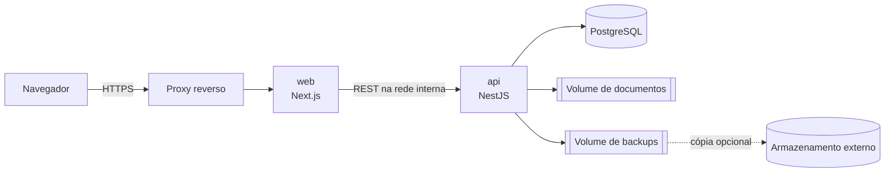
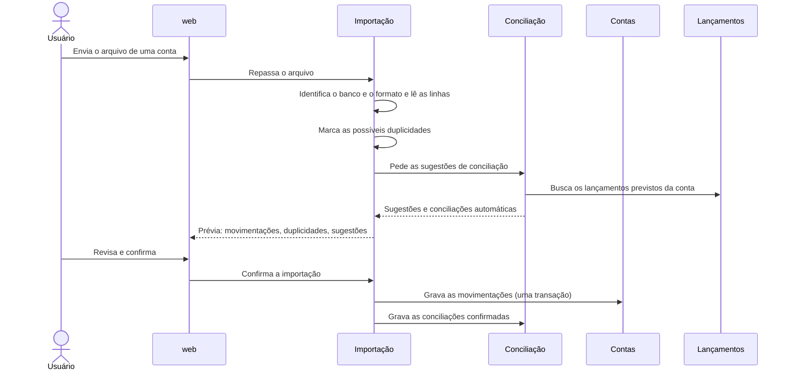

# High-level design

Este documento descreve a arquitetura do finance: os componentes, os módulos do monólito e as fronteiras entre eles, os fluxos principais e as decisões técnicas que valem para o sistema inteiro. Ele parte do `product-brief.md` e usa o vocabulário do `GLOSSARY.md`. As bibliotecas, a estrutura de pastas, o esquema do banco, os contratos de API, as regras de negócio e as variáveis de ambiente ficam no `lld.md`. As decisões difíceis de reverter têm um ADR em `docs/adr/`, citado em cada seção.

## 1. Visão geral

O finance é uma aplicação web para uma família: as finanças de cada entidade (pessoa física ou jurídica) ficam separadas, e as visões consolidadas somam grupos delas. Tudo entra por arquivo importado ou digitado. Não há integração online com bancos, adquirentes nem prefeituras.

- **Uma família por instalação.** Cada instalação tem um banco, com todas as entidades e todos os usuários de uma família. Não existe inquilino, e outra família exige outra instalação ([ADR 0005](adr/0005-uma-familia-por-instalacao.md)).
- **Uma instalação ativa de cada vez,** na nuvem ou num servidor local, sem sincronização entre instalações. A troca de ambiente é feita por backup e restauração (seção 8).
- **Monorepo com duas apps,** a `web` e a `api`, e um monólito modular dentro da `api`. Nenhuma regra de negócio fica na `web`.

## 2. Componentes

| Componente | O que faz | Exposto |
| --- | --- | --- |
| Proxy reverso | Termina o HTTPS e encaminha tudo para a `web` | Sim, a única porta pública |
| `web` (Next.js) | A interface e a única porta de entrada do navegador. Renderiza no servidor, chama a `api` e repassa o cookie de sessão | Só pelo proxy |
| `api` (NestJS) | Os módulos de domínio, a autenticação, a autorização, a auditoria, as tarefas agendadas e o backup | Não, só na rede interna |
| PostgreSQL | O único banco, com todos os dados da instalação | Não |
| Volume de documentos | Os arquivos anexados, atrás de uma interface de armazenamento da `api` | Não |
| Volume de backups | Os backups criptografados, com cópia opcional num armazenamento externo | Não |

**A `web` é a única porta de entrada.** O navegador fala só com a `web`. As páginas e as ações do servidor do Next chamam a `api` pela rede interna do Compose, com um cliente tipado gerado do contrato OpenAPI da `api`. Como a `api` não fica exposta, não há CORS nem cookie entre domínios ([ADR 0004](adr/0004-web-como-unica-porta-de-entrada.md)). Upload de extrato, upload e download de documento e exportação de relatório também passam pela `web`, em rotas que repassam o arquivo para a `api` sem guardá-lo.

**A `web` não guarda estado de domínio.** Ela não acessa o banco, não calcula saldo nem resultado e não decide permissão. Ela formata e mostra o que a `api` devolve, e valida formulários só para a experiência do usuário: a validação que vale é a da `api`.

**O contrato é a OpenAPI da `api`.** A `api` gera a especificação a partir dos controladores, e uma cópia dela fica no repositório. O cliente da `web` é gerado dessa cópia, então uma mudança de rota quebra a checagem de tipos da `web` no mesmo PR. O formato de cada rota e de cada tabela, e os arquivos do contrato que a skill de plano confere, são do LLD.

## 3. Módulos da `api`

Cada módulo é dono de um pedaço do domínio: das tabelas dele, das regras dele e dos termos do glossário que elas implementam. A tabela dá a fase do `product-brief.md` em que o módulo nasce.

| Módulo | É dono de | Fase |
| --- | --- | --- |
| Identidade | Usuários, senhas, sessões, segundo fator, recuperação de acesso e permissões | 1 |
| Entidades | Entidades, grupos financeiros (com a Visão Familiar), participação societária, as operações ligadas em cada empresa e a resolução do contexto financeiro | 1 |
| Auditoria | O registro de cada alteração financeira, com quem, quando, o registro e os valores anteriores e novos | 1 |
| Pesquisa | A rota de pesquisa: pede a cada módulo os registros dele que batem com o termo e junta os resultados. Não tem tabela e só lê | 1 |
| Contas | Contas, contas de reserva, cartões, faturas, movimentações (importadas, manuais e ajustes) e saldo inicial. Calcula o saldo | 2 |
| Lançamentos | Lançamentos, parcelas e as situações delas, recorrências, categorias, finalidade e transferências. É o dono das contas a pagar e a receber | 2 |
| Importação | Os arquivos importados, os leitores de cada banco e formato e a detecção de duplicidade. Grava as movimentações pelos Contas | 2 |
| Conciliação | A ligação entre movimentação e lançamento, as sugestões e a conciliação automática | 2 |
| Repasses | Repasses e os tipos deles, reembolso pendente e empréstimo entre entidades | 3 |
| Recebimentos | Formas de pagamento, taxa de recebimento, recebíveis, antecipação e estorno | 3 |
| Clínica | Clientes, procedimentos, atendimentos, pacotes e sessões, situação fiscal e anonimização de clientes. Só responde em empresa com a operação de clínica ligada | 4 |
| Estoque | Produtos, lotes, entradas, baixas e custo médio | 4 |
| Compras | Fornecedores, compras e entregas | 4 |
| Patrimônio | Bens, dívidas, reavaliações, aplicações e resgates | 5 |
| Planejamento | Metas e contribuições, orçamentos e projeção de caixa | 5 |
| Indicadores | Os números consolidados: resultado, custo de vida, taxa de poupança, patrimônio líquido, resultado gerencial e fluxo de caixa. Só lê | 2 em diante |
| Relatórios | A exportação em PDF e XLSX do que os outros módulos calculam. Só lê | 6 |
| Alertas | A lista de alertas que os outros módulos levantam e o que o usuário já leu | 3 em diante |
| Documentos | Os arquivos anexados, os metadados deles e o vínculo com os registros | 6 |
| Backup | Os backups automáticos e manuais, o histórico, a retenção e a verificação de integridade | 6 |

### Regras entre módulos

- **Cada módulo só acessa as próprias tabelas.** Para ler ou mudar algo de outro módulo, ele chama a interface pública desse módulo. Um módulo que precisaria criar ou mudar dado de outro domínio pede isso a ele, como o `AGENTS.md` da raiz pede. A regra é conferida pelo lint da `api`, como o LLD descreve.
- **As dependências não têm ciclo.** Os módulos de operação dependem dos financeiros, e nunca o contrário. Por exemplo, a Clínica chama Lançamentos, Recebimentos e Estoque; Compras chama Lançamentos e Estoque; Repasses chama Lançamentos; a Importação chama Contas e Conciliação; e a Conciliação chama Contas e Lançamentos. Indicadores, Relatórios e Alertas leem de todos, e ninguém depende deles.
- **Um comando é uma transação.** Quando um comando atravessa módulos, como um atendimento que gera a receita, os recebíveis e a baixa de estoque, tudo acontece numa transação só do banco, com chamadas síncronas entre os módulos. Não há barramento de eventos nem fila. Ou o comando inteiro fica gravado, ou nada fica ([ADR 0006](adr/0006-modulos-sincronos-na-mesma-transacao.md)).
- **A Auditoria entra na mesma transação.** Cada alteração financeira grava o registro de auditoria junto com a mudança, e a auditoria nunca fica para trás nem à frente do dado.
- **Os alertas são derivados.** Cada módulo expõe as condições de alerta dele (um vencimento, um estoque abaixo do mínimo, um reembolso pendente, uma nota fiscal pendente), e o módulo de Alertas as consulta na hora de mostrar. Só o que o usuário já leu fica gravado. A falha de backup é a exceção, porque vem do histórico de backups, que é um dado como os outros.

## 4. Contexto financeiro e autorização

Toda requisição de dados traz o contexto financeiro escolhido: uma entidade ou um grupo financeiro. A `api` o resolve no módulo de Entidades, como a lista de entidades que a requisição pode ver, e confere em seguida se o usuário tem permissão em cada uma delas.

- **A `api` decide, a `web` só mostra.** A permissão é conferida em toda rota, no servidor, antes de qualquer leitura ou escrita.
- **Toda consulta é filtrada pelas entidades do contexto.** Nenhum módulo lê dados sem receber as entidades permitidas, e um número de outra entidade nunca aparece numa tela, como o critério do brief pede.
- **O modelo de permissões existe desde a fase 1,** com a permissão por usuário e entidade. No uso inicial, os dois usuários têm acesso total a todas as entidades, como o brief decide.
- **A Visão Familiar é um grupo financeiro como os outros.** A diferença dela é só aceitar pessoas físicas. O que ela soma, e como a transferência familiar e o empréstimo se anulam dentro dela, são regras do LLD.

## 5. Autenticação

A autenticação é implementada na própria `api`, sem biblioteca de autenticação pronta e sem provedor externo. Ela usa só primitivas consolidadas: o hash de senha e o gerador de códigos de uso único ([ADR 0003](adr/0003-autenticacao-propria-na-api.md)).

- **Senha:** guardada com hash argon2id. O login confere a senha e, se o segundo fator estiver ativo, pede o código.
- **Sessão:** um token aleatório opaco, num cookie `httpOnly`, `Secure` e `SameSite=Lax` do domínio da `web`. O banco guarda só o hash do token, com a criação, o último uso e a expiração. A sessão expira por inatividade e por tempo máximo. O usuário lista as próprias sessões e encerra qualquer uma, e a troca de senha encerra as outras.
- **Segundo fator:** TOTP (RFC 6238), com códigos de recuperação de uso único. É opcional por usuário.
- **Recuperação de acesso:** um link de uso único com validade curta, guardado como hash. Como o sistema não envia e-mail, o link é gerado por outro usuário com permissão de gerir acessos, ou, quando ninguém mais consegue entrar, por um comando no servidor.
- **Proteção contra tentativa e erro:** um limite de tentativas por conta e por origem no login, na confirmação do segundo fator e no uso do link de recuperação.
- **CSRF:** o cookie `SameSite=Lax`, a conferência de origem das ações do servidor do Next e a `api` fora da internet.

> **Para revisar:** a recuperação sem e-mail segue o documento de contexto, que exclui notificação por e-mail. Se for preciso recuperar o acesso sozinho, sem outro usuário, entra o envio de e-mail só para esse caso, com um servidor SMTP configurado.

## 6. Dados

- **Um banco PostgreSQL** com todos os dados da instalação, incluindo a auditoria e o histórico de backups. O esquema muda só por migrações versionadas, aplicadas na subida da `api`.
- **Valores exatos.** Todo valor monetário é decimal exato no banco e no código, e nunca ponto flutuante. Os valores estão em BRL. A precisão de cada tipo de valor (dinheiro, custo médio, fração de participação societária) e as regras de arredondamento são do LLD.
- **Datas.** Cada lançamento guarda a data do fato e a data do pagamento, como o ADR 0001 pede. Datas de calendário são guardadas sem hora, e instantes, com fuso. O "hoje" e os limites de cada mês são calculados no fuso America/Sao_Paulo.
- **Saldos e resultados são calculados, e não guardados.** O saldo de uma conta é o saldo inicial mais as movimentações, e os indicadores são consultas sobre os lançamentos. Não há tabela de saldo nem projeção mantida em paralelo, então não há o que dessincronizar. Se uma consulta ficar lenta, a primeira resposta é um índice. Um saldo guardado só entra com medição que o justifique, num ADR.
- **Nenhum registro financeiro é apagado de verdade sem auditoria.** O que se pode excluir e o que só se cancela é do LLD. A anonimização de clientes substitui os dados pessoais e mantém os atendimentos e os valores, como o ADR 0002 e o glossário pedem.
- **Idioma e região.** A interface está em português do Brasil, com formatação pt-BR, e os textos ficam centralizados na `web` para permitir outros idiomas.

## 7. Tarefas agendadas

As tarefas agendadas rodam dentro da `api`, num agendador do próprio processo. Como só uma instância da `api` roda por instalação, não há fila nem disputa entre instâncias. Toda tarefa é idempotente: rodar duas vezes, ou de novo depois de uma falha, dá o mesmo resultado.

| Tarefa | Quando | Módulo |
| --- | --- | --- |
| Gerar as previsões das recorrências | Diária | Lançamentos |
| Backup automático | Diária, no horário configurado | Backup |
| Aplicar a retenção dos backups | Depois de cada backup | Backup |
| Limpar sessões e links de recuperação expirados | Diária | Identidade |

As situações que dependem só da data, como uma parcela vencida, são calculadas na consulta, e não por tarefa.

## 8. Backup e restauração

- **O que entra:** o dump do banco e o volume de documentos, num arquivo só, criptografado com uma chave da configuração, com o checksum gravado ao lado.
- **Onde fica:** no volume de backups e, se configurado, também num armazenamento externo compatível com S3. A retenção é configurável.
- **Quando:** diário, pela tarefa agendada, e manual, pela interface. Cada backup grava no histórico o resultado, o tamanho e o checksum. Uma falha vira alerta.
- **Verificação:** depois de gravar, o backup confere o checksum do arquivo.
- **Restauração:** é um comando operacional no servidor, com a aplicação parada, e não uma tela. Ele decifra o arquivo, confere o checksum, restaura o banco e os documentos e sobe a aplicação. É também o caminho da troca de ambiente.
- **A chave fica fora do servidor.** Um backup sem a chave não se restaura, então ela é guardada também num lugar separado da instalação. O critério 5 do brief prova a restauração num ambiente limpo antes da produção.

> **Para revisar:** o brief pede "poder restaurá-los". A restauração por comando, e não pela interface, evita que um clique sobrescreva a base em uso. A interface mostra o histórico e dispara o backup manual.

## 9. Fluxos principais

### Importação e conciliação

Um formato desconhecido falha antes da prévia, com mensagem clara, e nada é gravado. Reimportar o mesmo arquivo não duplica movimentações. O critério de duplicidade e o de conciliação automática são do LLD.

### Atendimento pago no cartão

Num comando só, e numa transação só:

1. A **Clínica** registra o atendimento, ou a sessão de um pacote, na empresa do contexto.
2. A **Clínica** pede a **Lançamentos** a receita, pelo valor bruto, na data do pagamento (ADR 0001).
3. A **Clínica** pede a **Recebimentos** os recebíveis da adquirente, líquidos da taxa de recebimento, que vira despesa financeira.
4. A **Clínica** pede a **Estoque** a baixa dos materiais, com o lote e o custo médio.
5. A **Auditoria** registra tudo junto.

A rentabilidade do atendimento é calculada depois, pelos Indicadores, a partir desses registros.

### Despesa da clínica paga com o cartão pessoal

1. O usuário registra a despesa na empresa, com a pessoa física como pagadora.
2. **Lançamentos** grava a despesa na empresa e a saída de dinheiro no cartão da pessoa física.
3. **Repasses** abre o reembolso pendente da empresa para a pessoa física, e o alerta aparece enquanto ele estiver em aberto.
4. Um repasse do tipo reembolso, ou a conversão em aporte, quita o reembolso.

### Compra e entrega

A **Compra** gera as parcelas a pagar em **Lançamentos**, pelo valor combinado. Só a **Entrega** pede ao **Estoque** a entrada dos produtos, que recalcula o custo médio.

## 10. Segurança e privacidade

- Só o proxy reverso tem porta publicada. A `api`, o banco e os volumes ficam na rede interna.
- Segredos e configuração vêm de variáveis de ambiente, e nenhum entra no repositório. O `scripts/verify.sh` confere segredos em todo PR.
- Os documentos só são servidos pela `api`, depois de conferir a permissão na entidade do registro a que estão vinculados. Não há URL pública de arquivo.
- Os logs não trazem senha, token, CPF nem conteúdo de documento.
- **Sem dados de saúde** de clientes (ADR 0002).
- **Arquivos reais de banco não entram no repositório.** As amostras de teste da importação são versões anonimizadas dos extratos reais: mesma estrutura, com nomes, documentos, contas e valores trocados.

## 11. Operação

- **Implantação:** um Compose de produção com o proxy, a `web`, a `api` e o banco, e volumes para o banco, os documentos e os backups. A infraestrutura definitiva é escolhida depois do desenvolvimento, como o documento de contexto prevê, e o mesmo Compose roda num servidor local ou numa máquina na nuvem.
- **Desenvolvimento:** o `compose.dev.yaml`, com cada app entrando nele no ticket que a cria, como o `AGENTS.md` da raiz descreve.
- **Saúde:** a `api` e a `web` têm uma rota de saúde, usada pelo healthcheck do Compose.
- **Logs:** estruturados, na saída padrão, com o identificador da requisição atravessando a `web` e a `api`. Não há serviço externo de monitoramento.

## 12. Testes

A pirâmide de testes do `AGENTS.md` da raiz, aplicada a esta arquitetura:

- **Unitários:** as regras de domínio de cada módulo (cálculo de saldo, custo médio, tipos de repasse, regime de caixa, conciliação), como funções puras, sem banco.
- **Integração:** as rotas da `api` contra um PostgreSQL real no contêiner, com as transações entre módulos, a auditoria e as permissões por entidade.
- **Ponta a ponta:** os fluxos principais pela `web`, no navegador.
- **Importação:** cada leitor de banco tem as amostras anonimizadas como fixture, e uma mudança de formato aparece como teste quebrado.

Os comandos, as ferramentas e as camadas de cada app ficam no `AGENTS.md` dela.

## 13. O que fica para o LLD

- A estrutura de pastas do monorepo e de cada app, e as bibliotecas escolhidas.
- O esquema do banco, módulo a módulo, e os tipos e a precisão de cada valor.
- O formato do contrato de rota e de tabela e os arquivos do contrato.
- As regras de negócio que o domínio deixou para o LLD: a conciliação automática (e o caso de duas previsões iguais em datas próximas), o critério de duplicidade, o ciclo da fatura, o ajuste de saldo, o frete no custo médio, a soma da Visão Familiar com transferências familiares e empréstimos, e a retenção pela LGPD.
- Os tempos de sessão, os limites de tentativas e os horários das tarefas.
- As variáveis de ambiente.
